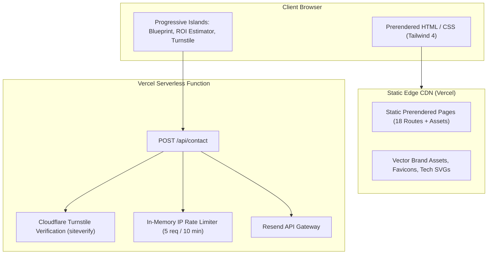

# Vital Tech Myanmar — Technical Site Architecture

This document provides a comprehensive technical overview of the architecture, content model, routing structure, interactive components, security integrations, and design system of the Vital Tech Myanmar marketing platform.

---

## 1. High-Level Architecture

The platform is built on modern web standards prioritizing fast time-to-first-byte (TTFB), complete search engine accessibility, and strict operational security:



- **Astro 7.2.8 (`output: 'static'`)**: All content pages are prerendered at build time. The site serves zero unnecessary JavaScript to static readers.
- **Vercel Adapter (`@astrojs/vercel`)**: Uses Vercel's Build Output API v3. Pages are distributed across Vercel's edge network, while the contact form submits to an on-demand serverless endpoint (`src/pages/api/contact.ts`).
- **Tailwind CSS 4.3.3**: Built with `@tailwindcss/vite` and CSS-first `@theme` design tokens in `src/styles/global.css` (no legacy `tailwind.config.js`).
- **Resend & Cloudflare Turnstile**: Enterprise email delivery protected by cryptographic Turnstile bot defense, honeypot inputs, and IP rate-limiting.

---

## 2. Centralized Content Architecture

To prevent copy fragmentation, all site text, navigation, contact details, services, industries, insights, and metadata live in **`src/content/site.ts`** and are typed strictly in **`src/types/site.ts`**.

```text
src/
├── types/
│   └── site.ts           # Type definitions for all entities, pages, and components
├── content/
│   └── site.ts           # Single source of truth for site copy, data, and metadata
└── lib/
    └── site.ts           # Helper functions (canonical URLs, route metadata, lookups)
```

### Core Principles
1. **Zero Hardcoded Copy**: Components and pages must never hardcode marketing copy, contact details, or technical capabilities.
2. **Strict Route Typing**: Routes must satisfy the `RoutePath`, `ServiceRoutePath`, `IndustryRoutePath`, or `InsightRoutePath` unions in `src/types/site.ts`.
3. **Derived Metadata**: Dynamic pages compute title and Open Graph metadata using helper functions in `src/lib/site.ts` with fallback chains.

---

## 3. Routes & Page Structure

| Route | Template File | Rendering Mode | Purpose |
|---|---|---|---|
| `/` | `src/pages/index.astro` | Prerendered | Homepage: Hero, Trust Proof metrics, Services overview, Tech Ecosystem, and CTAs |
| `/services` | `src/pages/services.astro` | Prerendered | Services hub: Service cards, Cloud Architecture Blueprint, and Cloud ROI Estimator |
| `/services/[id]` | `src/pages/services/[id].astro` | Prerendered (`getStaticPaths`) | 6 deep-dive technical delivery playbooks with scopes, delivery phases, and FAQs |
| `/industries` | `src/pages/industries.astro` | Prerendered | Industry sector hub showcasing domain solutions and operational outcomes |
| `/industries/[id]` | `src/pages/industries/[id].astro` | Prerendered (`getStaticPaths`) | 4 industry playbooks: Financial Services, Digital Commerce, Growing Enterprises, Professional Services |
| `/about` | `src/pages/about.astro` | Prerendered | About page: Principles, Engineering Competencies, Regional Infrastructure, SLAs, and Engagement Models |
| `/insights` | `src/pages/insights.astro` | Prerendered | Thought leadership and technical articles hub |
| `/insights/[slug]` | `src/pages/insights/[slug].astro` | Prerendered (`getStaticPaths`) | 6 long-form technical reading articles with estimated read times and rich bodies |
| `/contact` | `src/pages/contact.astro` | Prerendered | Direct contact options, verified channels, and progressive Turnstile contact form |
| `/404` | `src/pages/404.astro` | Prerendered | Branded error page with high-contrast display and directory back to core hubs |
| `/api/contact` | `src/pages/api/contact.ts` | On-Demand Serverless | Turnstile verification, payload validation, honeypot filter, and Resend delivery |
| `/robots.txt` | `src/pages/robots.txt.ts` | Prerendered | Dynamic crawler directives linking to sitemap index |

---

## 4. Key Interactive Components

### `ArchitectureBlueprint.astro` (`/services`)
- **Purpose**: Visualizes Vital Tech's 5-stage software delivery lifecycle:
  1. *Source & Policy* (Trunk-based branch protection, signed commits)
  2. *Build & Security* (Containerized runners, SAST, SCA, image digest pinning)
  3. *Infrastructure as Code* (Terraform, Ansible, state locking, drift control)
  4. *GitOps & Delivery* (Argo CD, Kubernetes, blue-green & canary rollouts)
  5. *Telemetry & SRE* (OpenTelemetry, Prometheus, Grafana, SLO alerts)
- **Features**: Accessible tab navigation (`role="tablist"`), keyboard arrow navigation, verification gate checklists, and official vector tech icons.

### `CloudRoiCalculator.astro` (`/services`)
- **Purpose**: Self-service assessment tool for engineering managers and CTOs to quantify the value of managed cloud operations and CI/CD automation.
- **Controls**:
  - Monthly Cloud Spend slider ($1,000 to $50,000+ USD)
  - Engineering Team Size slider (2 to 60+ engineers)
  - Deployment Cadence selector (Monthly, Bi-Weekly, Weekly, Daily)
- **Dynamic Outputs**:
  - Estimated Annual Cloud Cost Savings (22% baseline waste reduction)
  - Reclaimed Developer Hours per Month
  - Release Velocity Acceleration factor (up to 5.2x faster)
  - Direct 1-click CTA to pre-fill inquiry on `/contact`

### `TrustProof.astro` (`/`)
- **Purpose**: Operational social proof highlighting real delivery baselines.
- **Content**:
  - Key Delivery Metrics (uptime, deployment speedup, cost reduction)
  - Enterprise Endorsements (Finance, Commerce, Logistics)
  - Engineering Governance Standards (Zero configuration drift, least-privilege security, auditable delivery gates)

### `ContactForm.astro` (`/contact`)
- **Purpose**: Low-friction inquiry submission with progressive enhancement.
- **Security & Reliability**:
  - Progressive enhancement: Works via AJAX `fetch` with native HTML fallback.
  - Cloudflare Turnstile bot protection: Server-side `siteverify` token challenge.
  - Honeypot filter: Silently drops bot submissions filling hidden fields.
  - In-memory IP rate limiter: 5 submissions per 10 minutes per IP.

---

## 5. Design System & Brand Assets

The visual identity uses a modern navy/cobalt palette defined via Tailwind 4 tokens in `src/styles/global.css`:

### Semantic Theme Tokens
- `--color-canvas`: `#f7f9fc` (Background surface)
- `--color-surface`: `#ffffff` (Card background)
- `--color-surface-muted`: `#eef3f9` (Subtle container background)
- `--color-ink`: `#102a4c` (Primary text color)
- `--color-muted`: `#526073` (Secondary text color)
- `--color-line`: `#cbd5e1` (Borders and rules)
- `--color-accent`: `#2454d8` (Primary brand cobalt)
- `--color-accent-soft`: `#dce7ff` (Pill badges and highlights)

### Official Vector Brand Assets
- **Primary Wordmark**: `public/vital-tech-primary.svg` (Header and branding)
- **Official V Icon**: `public/vital-tech-icon.svg` (Gradient geometric V symbol)
- **Web App Favicon**: `public/favicon.svg` (64×64 vector icon)
- **iOS Web Clip**: `public/apple-touch-icon.png` (180×180 raster icon)
- **Open Graph Social Card**: `public/og-preview.svg` (1200×630 SVG social preview card)
- **Technology Icons**: `public/technology-icons/` (Official SVGs for AWS, Linux, Kubernetes, Terraform, Prometheus, Grafana, OpenTelemetry, Docker, Helm, Argo CD, GitLab, GitHub, Red Hat, OpenStack, Ansible)
- **Service Illustrations**: `public/service-illustrations/` (Custom SVG diagrams per service)

---

## 6. Environment Variables

Configure these variables in your local `.env` and in **Vercel Project Settings → Environment Variables**:

| Variable | Scope | Required | Default / Example | Purpose |
|---|---|---|---|---|
| `RESEND_API_KEY` | Server | Yes | `re_...` | API key used by `/api/contact` to send inquiry emails |
| `CONTACT_FROM_EMAIL` | Server | No | `onboarding@resend.dev` | Sender address (must use a verified domain in Resend for production) |
| `CONTACT_TO_EMAIL` | Server | No | `info@vitaltechmyanmar.com` | Delivery inbox for contact form submissions |
| `PUBLIC_TURNSTILE_SITEKEY` | Client & Server | Yes | `0x4AAAAAA...` | Public Cloudflare Turnstile sitekey rendered in the widget |
| `TURNSTILE_SECRET` | Server | Yes | `0x4AAAAAA...` | Server-only Turnstile secret for `siteverify` token validation |
| `TURNSTILE_HOSTNAMES` | Server | No | `vitaltechmyanmar.com,localhost` | Comma-separated list of allowed frontend hostnames |

---

## 7. Operational Workflow Rules

1. **No Local Builds in WSL**: Local build, test, and dev commands are avoided in WSL checkouts per repository workflow. Verification occurs statically and via Vercel deployments.
2. **Working Tree Discipline**: Changes are left unstaged/uncommitted for the developer to review and commit manually.
3. **Change Log Requirement**: Every functional or configuration change must append a dated entry to `AGENTS.md`.
